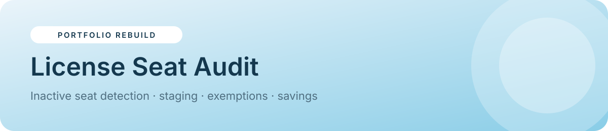

<p align="center"></p>

<p align="center">


<a href="https://sider.ai/agents/web-creator/share/695ea81100a621619985fdfb"></a>
</p>

<p align="center"><a href="https://naekitakadoportfolio.github.io/license-seat-audit/"></a></p>

# License Seat Audit

A multi-page app for reclaiming unused software seats before renewal. It flags inactive users, moves them through a safe lifecycle (flagged → staged → removed), protects legitimate low-usage seats with expiring exemptions, models renewal savings and generates a weekly stakeholder report.

> **Portfolio rebuild.** A from-scratch recreation of a production system I designed and run. It uses **fictional people and data**, with no client names, code or branding.

## ✨ Features
- **Dashboard:** paid seats, flagged/staged/removed counts, annual savings potential and inactivity by team
- **Seats directory:** 20 users with search, team filter and a detail modal (mark active, exempt)
- **Run audit:** configurable inactivity threshold, seat price and guest inclusion, with audit history
- **Staging & removals:** three-step lifecycle with bulk staging, Admin-only removal approval, restore and re-invite
- **Exemptions:** required reason (validated), expiry date, active/expired status
- **Savings model:** compares scenarios at renewal
- **Weekly report:** chat-style preview, channel picker and send log
- **Roles:** Ops Admin (approves removals), Team Lead (stages and exempts), Viewer (read-only)
- **Activity log**, persisted state, light/dark theme

## 🧭 Try it
1. Open the **[live demo](https://naekitakadoportfolio.github.io/license-seat-audit/)** → *Run audit* → **Run audit now**
2. In *Staging & removals*, stage a seat and exempt another (try an empty reason to see validation)
3. Switch to **Team Lead** and try approving a removal (blocked), then back to **Ops Admin**
4. Send the weekly report

## 🏗 Production architecture
| Layer | Production | This demo |
|---|---|---|
| Data source | Workspace members + last-active via REST API | Seeded users |
| Storage | Google Sheets staging & exemptions tabs | `localStorage` |
| UI | Apps Script web app dashboard | Static SPA |
| Reporting | Weekly Slack webhook (Mondays 08:00) | Simulated send log |

## 📁 Project structure
```
license-seat-audit/
├── index.html        # built app (shell + app code, single file)
├── src/
│   ├── app.js        # views, state seed, business logic
│   └── app.json      # title, navigation, theme, storage key
├── assets/banner.svg # README banner
├── README.md
└── LICENSE
```

## 🚀 Run locally
No build step is needed to run it. Open `index.html`, or serve the folder:
```bash
python3 -m http.server 8000   # then visit http://localhost:8000
```
`index.html` is generated from `src/` by a small shared shell (hash router, persisted state, modals, toasts, light/dark theme).

## 🧩 Implementation notes
- Exempt users (`isEx`) are skipped by every audit run until the exemption expires
- Removal requires the Admin role, so staging and removing are separate permissions
- Savings = (flagged + staged + removed) × seat price × 12

## 🗺 Roadmap
- Automatic 7-day owner notice emails
- SSO group sync to auto-exempt service accounts
- Usage-tier downgrade suggestions (instead of removal)

---
<p align="center"><sub>Built by <b>Nae Kitakado</b>, AI Automation Consultant · <a href="https://www.linkedin.com/in/nae-k-203194265">LinkedIn</a> · <a href="https://sider.ai/agents/web-creator/share/695ea81100a621619985fdfb">Portfolio</a> · open to retainer &amp; part-time consulting</sub></p>
